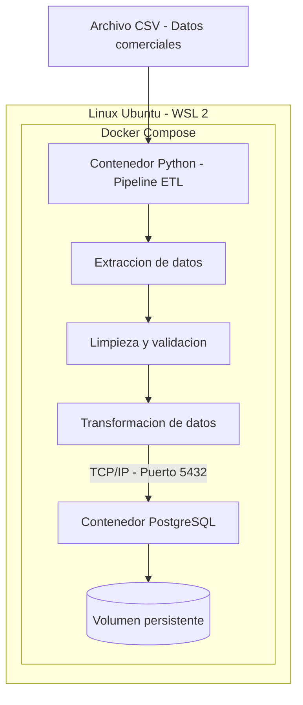

# Cloud Data Pipeline

## Descripción del proyecto

Sistema automatizado de extracción, transformación y carga
de datos (ETL), desarrollado mediante Python, PostgreSQL,
Linux y Docker.

El proyecto simula un entorno empresarial donde es necesario
procesar, validar y almacenar información comercial mediante
una infraestructura de contenedores reproducible.

## Objetivos

- Automatizar el procesamiento de información.
- Implementar un pipeline ETL.
- Garantizar la integridad de los datos.
- Configurar servicios mediante contenedores.
- Implementar comunicación entre servicios.
- Gestionar configuraciones mediante variables de entorno.
- Aplicar control de versiones y documentación técnica.

## Tecnologías utilizadas

| Tecnología | Aplicación |
|---|---|
| Python | Programación y automatización |
| Pandas | Limpieza y transformación de datos |
| SQL | Consultas y gestión de información |
| PostgreSQL | Base de datos relacional |
| Psycopg | Conexión entre Python y PostgreSQL |
| Linux Ubuntu | Entorno de desarrollo |
| WSL 2 | Integración de Linux con Windows |
| Docker | Implementación de contenedores |
| Docker Compose | Gestión de múltiples servicios |
| Git | Control de versiones |
| GitHub | Repositorio y documentación |
| Visual Studio Code | Desarrollo de código |

## Arquitectura del sistema



La infraestructura está compuesta por dos servicios
independientes, conectados mediante una red interna de Docker.

- Servicio Python: procesamiento automatizado de datos.
- Servicio PostgreSQL: almacenamiento de información.
- Red interna: comunicación entre contenedores mediante TCP/IP.
- Volumen persistente: conservación de los datos.
- Variables de entorno: configuración de credenciales.
- Healthcheck: comprobación de disponibilidad de PostgreSQL.

## Estructura del proyecto

```text
cloud-data-pipeline/
│
├── data/
│   └── ventas.csv
│
├── src/
│   └── pipeline.py
│
├── sql/
│   └── init.sql
│
├── .dockerignore
├── .gitignore
├── Dockerfile
├── docker-compose.yml
├── requirements.txt
└── README.md
```

## Funcionamiento del pipeline ETL

### 1. Extracción (Extract)

Lectura de registros comerciales desde un archivo CSV
mediante Python y Pandas.

### 2. Transformación (Transform)

- Conversión de tipos de datos.
- Eliminación de registros incompletos.
- Eliminación de registros duplicados.
- Validación de cantidades y precios.
- Cálculo del importe total por venta.

### 3. Carga (Load)

- Conexión con PostgreSQL mediante Psycopg.
- Inserción de registros válidos.
- Prevención de inserciones duplicadas.
- Almacenamiento persistente de información.

## Funcionalidades implementadas

- Procesamiento automatizado de datos.
- Validación y limpieza de información.
- Gestión de bases de datos relacionales.
- Restricciones de integridad mediante SQL.
- Comunicación entre contenedores.
- Registro de eventos mediante logging.
- Gestión de dependencias de Python.
- Configuración de imágenes mediante Dockerfile.
- Gestión de servicios mediante Docker Compose.
- Persistencia de datos mediante volúmenes.
- Gestión de credenciales mediante variables de entorno.
- Control de versiones mediante Git.

## Resultados obtenidos

| Indicador | Resultado |
|---|---:|
| Registros originales | 12 |
| Registros válidos | 9 |
| Registros descartados | 3 |
| Porcentaje de registros válidos | 75% |
| Importe total procesado | $103,400 MXN |
| Registros duplicados en segunda ejecución | 0 |

Los datos utilizados en este proyecto son ficticios y fueron
generados exclusivamente con fines de aprendizaje.

## Pruebas de funcionamiento

Se realizaron las siguientes pruebas:

- Ejecución del pipeline de Python.
- Validación y transformación de registros.
- Conexión entre Python y PostgreSQL.
- Ejecución de servicios mediante Docker Compose.
- Consulta y verificación de registros mediante SQL.
- Segunda ejecución del pipeline sin duplicar información.

### Prueba de idempotencia

Al ejecutar nuevamente el pipeline con los mismos datos,
el sistema no genera registros adicionales gracias a la
clave primaria y la instrucción ON CONFLICT DO NOTHING.

Resultado:

```text
Registros nuevos insertados: 0
Carga de datos completada
Pipeline ETL completado correctamente
```

## Instalación y ejecución

### Requisitos

- Git
- Docker
- Docker Compose

### 1. Clonar el repositorio

```bash
git clone https://github.com/yeyo11arreola-cpu/cloud-data-pipeline.git
cd cloud-data-pipeline
```

### 2. Configurar las variables de entorno

Crear un archivo llamado `.env` en la raíz del proyecto.

Agregar la siguiente variable, utilizando una contraseña
propia:

```env
DB_PASSWORD=TU_CONTRASENA
```

El archivo `.env` está excluido del control de versiones
mediante `.gitignore`.

### 3. Iniciar PostgreSQL

```bash
docker compose up -d db
```

### 4. Construir y ejecutar el pipeline

```bash
docker compose run --rm --build pipeline
```

### 5. Consultar la base de datos

```bash
docker compose exec db psql -U pipeline_user -d ventas_db
```

### 6. Verificar los registros almacenados

```sql
SELECT * FROM ventas;
```

Consultar la cantidad de registros y el importe total:

```sql
SELECT COUNT(*) AS registros,
       SUM(total) AS ventas_totales
FROM ventas;
```

Consultar las ventas agrupadas por ciudad:

```sql
SELECT ciudad,
       SUM(total) AS ventas_totales
FROM ventas
GROUP BY ciudad
ORDER BY ventas_totales DESC;
```

### 7. Consultar el estado de los servicios

```bash
docker compose ps
```

### 8. Consultar registros de PostgreSQL

```bash
docker compose logs db
```

### 9. Detener los servicios

```bash
docker compose down
```

## Seguridad y configuración

El proyecto incorpora las siguientes prácticas básicas:

- Exclusión de credenciales del repositorio.
- Configuración mediante variables de entorno.
- Validación de información mediante restricciones SQL.
- Comunicación entre servicios mediante una red interna.
- Exclusión de archivos innecesarios mediante .dockerignore.

## Próximas mejoras

- [ ] Implementar Kubernetes.
- [ ] Desplegar la infraestructura en AWS.
- [ ] Implementar Terraform.
- [ ] Automatizar pruebas mediante GitHub Actions.
- [ ] Implementar integración y entrega continua (CI/CD).
- [ ] Incorporar herramientas de monitoreo.
- [ ] Automatizar la ejecución periódica del pipeline.
- [ ] Implementar gestión de registros rechazados.

## Objetivo profesional

Aplicar y desarrollar conocimientos prácticos de
infraestructura Cloud, Linux, contenedores, automatización,
programación e ingeniería de datos mediante la implementación
de soluciones tecnológicas reproducibles.

Este proyecto personal de aprendizaje guiado fue implementado
y probado en un entorno local.

## Autor

**Diego Iram Arreola de la Garza**

Ingeniero Mecatrónico | Cloud e Ingeniería de Datos

Interés profesional en infraestructura Cloud, automatización,
procesamiento de datos y desarrollo de soluciones tecnológicas.

- GitHub: [yeyo11arreola-cpu](https://github.com/yeyo11arreola-cpu)
